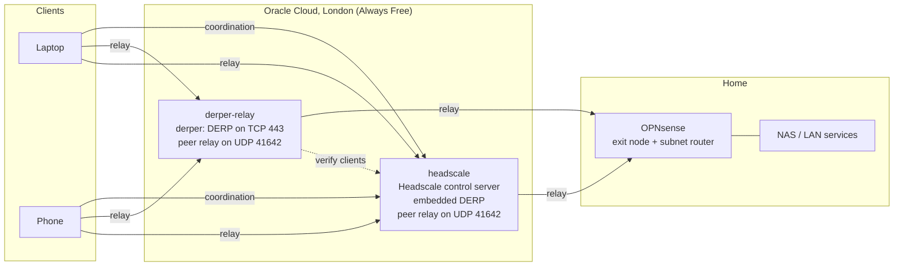

# Self-Hosted Tailscale Stack on Oracle Cloud Free Tier

A fully self-hosted [Tailscale](https://tailscale.com)-compatible network: my own control server ([Headscale](https://github.com/juanfont/headscale)), my own DERP relays, and Tailscale peer relays, running on two Oracle Cloud Always Free VMs. A home OPNsense router acts as the exit node and subnet router.

The goal was reliable access to my home lab (NAS, media server, 3D model files) from restrictive networks, without depending on Tailscale's hosted coordination or relay servers, and without opening any ports on my home network.

> All domains, IP addresses and keys below are placeholders. Replace `example.com`, `<DERP_PUBLIC_IP>`, `<HEADSCALE_PUBLIC_IP>` and so on with your own.

---

## Architecture



| Machine | Role | Runs |
|---|---|---|
| `derper-relay` (OCI VM 1) | Relay | `derper` (DERP over TCP 443, STUN on UDP 3478), `tailscaled` as a peer relay |
| `headscale` (OCI VM 2, different datacentre) | Control + relay | Headscale (control server and embedded DERP), `tailscaled` as a peer relay |
| OPNsense (home) | Gateway | Tailscale plugin as exit node and subnet router for the home LAN |
| Laptop, phone | Clients | Tailscale clients pointed at the Headscale server |

### How traffic finds its way

Tailscale always uses the best path available and falls back automatically:

1. **Direct** connection between two devices (WireGuard over UDP)
2. **Peer relay**: UDP relayed through one of the OCI VMs
3. **DERP relay**: TCP 443 relayed through one of the OCI VMs

Two VMs in separate datacentres means either one can carry all relayed traffic if the other is down. The relays only serve devices registered with my Headscale server.

---

## Requirements

- Two Oracle Cloud Always Free `VM.Standard.E2.1.Micro` instances (1/8 OCPU, 1 GB RAM), Ubuntu 24.04
- A domain with DNS you control (I use Cloudflare, with proxying **off**)
- Clients on Tailscale **1.80 or newer** (Headscale 0.29 rejects older clients)
- Versions used: Headscale 0.29.4, Tailscale 1.102 to 1.104

---

## 1. Base VM setup (both machines)

### DNS

Create A records pointing at each VM's public IP, set to **DNS only** (grey cloud in Cloudflare). A proxied record breaks DERP: the proxy terminates TLS and can't carry STUN.

```
derp.example.com       A  <DERP_PUBLIC_IP>
headscale.example.com  A  <HEADSCALE_PUBLIC_IP>
```

Reserve both public IPs in OCI so they don't change when an instance is stopped and started.

### Firewalls: OCI has two

Oracle Cloud filters traffic in **two** places, and both must allow it:

1. **The VCN security list** (cloud console). Add ingress rules there, and make sure they go on the **subnet the instance actually uses** (Instance → Primary VNIC → Subnet → Security Lists).
2. **The host's own iptables.** Oracle's Ubuntu image ships with a `REJECT` rule, so new rules must be *inserted* (`-I`) above it, not appended.

```bash
sudo mkdir -p /etc/iptables
sudo iptables -I INPUT -p tcp --dport 443 -j ACCEPT     # HTTPS / DERP / Headscale
sudo iptables -I INPUT -p tcp --dport 80 -j ACCEPT      # Let's Encrypt HTTP-01
sudo iptables -I INPUT -p udp --dport 3478 -j ACCEPT    # STUN
sudo iptables -I INPUT -p udp --dport 41641 -j ACCEPT   # tailscaled (direct connections)
sudo iptables -I INPUT -p udp --dport 41642 -j ACCEPT   # peer relay
sudo netfilter-persistent save
sudo iptables -L INPUT -n --line-numbers                # ACCEPTs must sit above REJECT
```

In the security lists, set **Source Port Range** to `All`. Only the destination port matters, since clients send from random ports.

### Swap

1 GB of RAM with no swap means the kernel will kill a process (possibly your relay) during a memory spike.

```bash
sudo fallocate -l 2G /swapfile && sudo chmod 600 /swapfile
sudo mkswap /swapfile && sudo swapon /swapfile
echo '/swapfile none swap sw 0 0' | sudo tee -a /etc/fstab
```

### Automatic security updates

```bash
sudo apt install -y unattended-upgrades
sudo dpkg-reconfigure -plow unattended-upgrades
```

In `/etc/apt/apt.conf.d/50unattended-upgrades`:

```
Unattended-Upgrade::Automatic-Reboot "true";
Unattended-Upgrade::Automatic-Reboot-WithUsers "true";
Unattended-Upgrade::Automatic-Reboot-Time "03:30";
```

Give each VM a **different reboot time** (e.g. 03:30 and 04:30) so both relays are never down at once.

---

## 2. Headscale (VM 2)

### Install

```bash
VER=$(curl -s https://api.github.com/repos/juanfont/headscale/releases/latest | grep -oP '"tag_name": "v\K[^"]+')
wget -O headscale.deb "https://github.com/juanfont/headscale/releases/download/v${VER}/headscale_${VER}_linux_amd64.deb"
sudo apt install -y ./headscale.deb
```

### Configure `/etc/headscale/config.yaml`

```yaml
server_url: https://headscale.example.com
listen_addr: 0.0.0.0:443

tls_letsencrypt_hostname: "headscale.example.com"
tls_letsencrypt_challenge_type: HTTP-01
tls_letsencrypt_listen: ":http"

derp:
  server:
    enabled: true                     # embedded DERP as a second relay region
    region_id: 999
    stun_listen_addr: "0.0.0.0:3478"
    automatically_add_embedded_derp_region: true
    ipv4: <HEADSCALE_PUBLIC_IP>
    # ipv6: leave commented out unless you have a real IPv6 address
  urls: []                            # drop Tailscale's public DERP servers
  paths: [/etc/headscale/derp.yaml]   # add the derper-relay region

policy:
  mode: file
  path: "/etc/headscale/policy.hujson"

dns:
  base_domain: tailnet.internal       # must differ from the server_url domain
```

### Relay map `/etc/headscale/derp.yaml`

Adds the standalone derper on VM 1 as a relay region:

```yaml
regions:
  900:
    regionid: 900
    regioncode: atom-derp
    regionname: Atom DERP
    nodes:
      - name: 900a
        regionid: 900
        hostname: derp.example.com
        stunport: 3478
        stunonly: false
        derpport: 443
```

### Policy `/etc/headscale/policy.hujson`

Allow all traffic between my devices, and let every device use both VMs as peer relays:

```json
{
  "grants": [
    {"src": ["*"], "dst": ["*"], "ip": ["*"]},
    {"src": ["*"], "dst": ["100.64.0.4", "100.64.0.5"], "app": {"tailscale.com/cap/relay": []}}
  ]
}
```

The relay addresses are the two VMs' tailnet IPs; check yours with `sudo headscale nodes list`.

### Start and verify

```bash
sudo headscale policy check --file /etc/headscale/policy.hujson
sudo systemctl enable --now headscale
curl https://headscale.example.com/health     # expect {"status":"pass"}
```

### Users and devices

```bash
sudo headscale users create <username>
sudo headscale users list                     # note the numeric ID

# Pre-auth key for headless devices (0.29 wants the numeric user ID)
sudo headscale preauthkeys create --user 1 --expiration 1h

# Approve an interactive login, using the auth ID from the login page
sudo headscale auth register --auth-id <AUTH_ID> --user <username>

sudo headscale nodes list
```

---

## 3. Standalone DERP relay (VM 1)

### Build derper

```bash
sudo apt install -y golang-go
go install tailscale.com/cmd/derper@latest    # Go auto-downloads a newer toolchain if needed
sudo cp ~/go/bin/derper /usr/local/bin/
```

### systemd unit `/etc/systemd/system/derper.service`

```ini
[Unit]
Description=Tailscale DERP server
After=network-online.target
Wants=network-online.target

[Service]
ExecStart=/usr/local/bin/derper \
  --hostname=derp.example.com \
  -a :443 \
  --http-port 80 \
  --certmode letsencrypt \
  --certdir /var/lib/derper/certs \
  --stun \
  --stun-port 3478 \
  --verify-client-url=https://headscale.example.com/verify \
  -c /var/lib/derper/derper.key
Restart=always
RestartSec=5
StateDirectory=derper
AmbientCapabilities=CAP_NET_BIND_SERVICE

[Install]
WantedBy=multi-user.target
```

```bash
sudo systemctl daemon-reload
sudo systemctl enable --now derper
curl -I https://derp.example.com              # expect HTTP 200
```

`--verify-client-url` asks Headscale whether each connecting device is registered, so strangers can't use the relay. If Headscale is unreachable, derper lets clients through by default, so the relay keeps working.

### Updating derper

The binary can't be overwritten while it's running ("Text file busy"), so stop it first:

```bash
sudo systemctl stop derper
go install tailscale.com/cmd/derper@latest
sudo cp ~/go/bin/derper /usr/local/bin/derper
sudo systemctl start derper
```

---

## 4. Peer relays (both VMs)

Peer relays forward WireGuard traffic over UDP. They're faster than DERP and kept working on a network where long-lived TCP connections to the DERP relay kept dropping.

Join each VM to Headscale, then enable the relay:

```bash
curl -fsSL https://tailscale.com/install.sh | sh
sudo tailscale up --login-server https://headscale.example.com --authkey <PREAUTH_KEY>

sudo tailscale set --relay-server-port=41642 \
  --relay-server-static-endpoints=<THIS_VM_PUBLIC_IP>:41642
```

**The static endpoint is essential on OCI.** The VM only sees its private address; the public IP is mapped to it from outside. Without `--relay-server-static-endpoints`, the relay advertises an address nobody can reach, and sessions sit at `<no handshake>` forever.

Verify:

```bash
# On a client
tailscale debug peer-relay-servers            # lists both relays
tailscale ping -c 30 <home-node>              # expect "via peer-relay(...)"

# On a relay VM
sudo tailscale debug peer-relay-sessions      # handshakes and rising packet counts
```

---

## 5. Home router: OPNsense exit node and subnet router

1. **System → Firmware → Plugins**: install `os-tailscale`.
2. **VPN → Tailscale → Authentication**: Login Server `https://headscale.example.com`, plus a pre-auth key. If the router was previously on another tailnet, it may need a `tailscale logout` from the shell (or a reboot) before it picks up the new server.
3. **VPN → Tailscale → Settings**: tick **Advertise Exit Node**, and advertise the LAN subnet under Advertised Routes.
4. **Interfaces → Assignments**: assign `tailscale0`, enable it, IPv4/IPv6 configuration **None**.
5. **Firewall → Rules → [Tailscale interface]**: Pass, direction In, any protocol, any source and destination. Leave "Interface (origin)" empty; it's only valid for outbound rules.
6. **Firewall → NAT → Source NAT**: in Automatic mode, OPNsense adds the Tailscale network to the outbound NAT rules by itself once the interface is assigned.
7. Approve the routes on Headscale. `approve-routes` **replaces** the approved list, so include everything:

```bash
sudo headscale nodes list-routes
sudo headscale nodes approve-routes --identifier <ID> --routes 0.0.0.0/0,::/0,<HOME_LAN_CIDR>
```

With the subnet route in place, the NAS and other LAN services are reachable by their normal LAN addresses through the router, so they don't need Tailscale installed themselves.

---

## 6. Clients

```bash
# Windows / Linux
tailscale login --login-server https://headscale.example.com
# If already logged in elsewhere, add --force-reauth to switch servers

# Away from home
tailscale set --exit-node=<opnsense-node> --accept-routes

# At home: turn both off (accept-routes on the LAN itself breaks local routing)
tailscale set --exit-node= --accept-routes=false
```

**Android:** log out, then use the menu option for an alternate server and enter the Headscale URL. Also set the app's battery usage to **Unrestricted** and enable **Always-on VPN**, or Android will suspend it and drop relay connections.

---

## Ports reference

| Port | Protocol | VM 1 (derper-relay) | VM 2 (headscale) | Purpose |
|---|---|:-:|:-:|---|
| 443 | TCP | ✓ | ✓ | DERP relay / Headscale API |
| 80 | TCP | ✓ | ✓ | Let's Encrypt certificate renewal |
| 3478 | UDP | ✓ | ✓ | STUN |
| 41641 | UDP | ✓ | ✓ | Direct connections to the VM itself |
| 41642 | UDP | ✓ | ✓ | Peer relay |

Nothing is opened on the home network.

---

## Lessons learned

Things that cost me time, in case they save you some:

- **Two firewalls on OCI.** Opening a port in the security list does nothing if the host's iptables `REJECT` rule sits above your `ACCEPT`.
- **Check which subnet a security list belongs to.** My peer relay rule ended up on the wrong subnet's list; everything looked right and nothing arrived.
- **Peer relays behind OCI need `--relay-server-static-endpoints`.** Without it, sessions are created but never complete a handshake.
- **Don't hardcode the relay's IP in the DERP map.** My original setup pinned an IPv4 address alongside a dynamic DNS name; when the address changed, clients kept dialling the old one.
- **Don't run a CPU keepalive on a burstable micro instance.** I tried a low-priority `stress-ng` load to avoid idle reclamation; it pushed the VM over its CPU baseline, the hypervisor throttled the whole machine, and relay throughput collapsed. Priority settings inside the VM don't help, because the throttling happens outside it.
- **Idle reclamation on E2.1.Micro** looks at CPU and network only (the memory condition applies to Ampere A1 shapes). Upgrading to Pay As You Go exempts instances, but expect a temporary card authorisation hold.
- **Headscale's embedded DERP config ships with an example IPv6 address** (`2001:db8::1`). If you uncomment the `ipv4:` line, make sure the `ipv6:` example stays commented out, or clients may try an address that doesn't exist.
- **A NAS container is a fragile exit node.** Every app update restarted it and took my whole connection down with it. The home router is a much better exit node: always on, and it doesn't restart for app updates.
- **The relay VM relays to itself.** Reaching the relay VM *as a device* over DERP depends on it relaying for itself, which was flaky. Opening UDP 41641 lets clients connect to it directly.
- **Headscale 0.29 CLI quirks:** `preauthkeys create --user` needs the numeric user ID, while `auth register --user` accepts the name.
- **Health warnings can be stale.** The Android app kept showing "relay server unavailable" while relayed pings worked. Test with an actual ping before chasing a warning.

---

## Maintenance checklist

- [ ] Back up `/etc/headscale` and `/var/lib/headscale` (the database and keys are your whole network). Stop Headscale briefly for a consistent copy, and back up before every upgrade.
- [ ] Back up `/etc/systemd/system/derper.service`, `/var/lib/derper` and `/var/lib/tailscale` on VM 1.
- [ ] Uptime monitoring on `https://derp.example.com` and `https://headscale.example.com/health`, to catch failed certificate renewals and stopped instances.
- [ ] A watchdog on an always-on home machine that restarts a stopped instance via the OCI CLI, as protection against idle reclamation.
- [ ] Rebuild derper when a Tailscale release matters (see above); Headscale upgrades via the release `.deb`, after reading the upgrade notes.

## Possible improvements

- Close public SSH on both VMs and connect over the tailnet instead (keeping the OCI serial console as a fallback).
- A static-port outbound NAT rule on OPNsense for Tailscale's UDP traffic, to improve direct connections for devices behind it.
- A travel router on the tailnet using the home exit node, so every device connected to it appears on the home connection.
